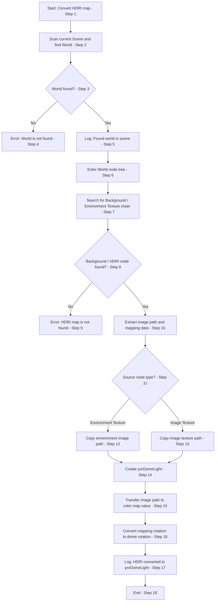
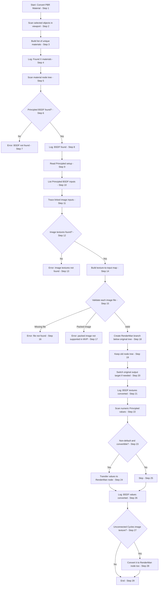
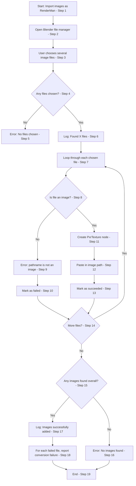

**Blenderman —** Blender plugin that converts PBR textures from cycles to [[Renderman]] equivalent for me in a separate sidebar UI panel plugin (aka rednerman node wrangler)

## 1. Goal and fixed scope

1. Build a Blender add-on that converts the common Node Wrangler Principled setup into a RenderMan-ready node branch, while keeping the original Blender graph intact below it.
    
2. The add-on must be a side-panel plugin under the RenderMan section, visible only in the Shader Editor / Material Node Editor.
    
3. MVP scope is intentionally narrow: only Node Wrangler-style PBR materials, only the routine 90% case, no ramps, no general-purpose shader graph conversion, no baking, no packed-texture handling. Node Wrangler’s Principled setup workflow is the baseline to target. ([Blender Documentation](https://docs.blender.org/manual/en/latest/addons/node/node_wrangler.html?utm_source=chatgpt.com "Node Wrangler - Blender 5.1 Manual"))

## 2. Version control and delivery process

1. Use JJ for local version control and create a GitHub repository for the project.
    
2. After each significant progression, the agent must create a commit on its own.
    
3. Use separate branches for different features, so each tool or subsystem can be reviewed and merged independently.
    

## 3. Add-on structure

1. Use one package with one UI entry module and separate operator modules.
    
2. Recommended layout:
    
    - `__init__.py` for registration and UI panel
        
    - `utils.py` for shared helpers
        
    - `convert_material.py`
        
    - `convert_world.py`
        
    - `convert_selected_nodes.py`
        
    - `import_textures.py`
        
3. Keep all node creation, linking, lookup, logging, and layout logic in `utils.py`. The operator files should stay thin and only orchestrate a scenario. Blender add-ons are expected to register classes through `register()` / `unregister()` and typically keep persistent logic outside the UI layer. ([Blender Documentation](https://docs.blender.org/api/current/info_overview.html?utm_source=chatgpt.com "API Overview - Blender Python API"))
    

## 4. UI panel requirements

1. The panel must appear in the Node Editor UI region, in a RenderMan category, and only when the current node tree is a shader tree.
    
2. It must contain exactly four distinct buttons in MVP:
    
    - Convert PBR Material
        
    - Convert HDRI Map
        
    - Convert Selected Nodes
        
    - Import Images as RenderMan Textures
        
3. No icons, no extra controls, no advanced settings in MVP. Panel visibility should be controlled through `poll()`, which is the standard Blender way to restrict UI classes by context. ([Blender Documentation](https://docs.blender.org/api/current/bpy.types.Panel.html?utm_source=chatgpt.com "Panel(bpy_struct) - Blender Python API"))
    

## 5. Development order

1. Step 1: create `utils.py` first, with heavy logging and tests. Battle-test node discovery, node editing, RenderMan node creation, and socket tracing.
    
2. Step 2: create the four operator scripts and implement each scenario one by one.
    
3. Step 3: create the UI panel and pack everything into a usable add-on.
    
4. Step 4: debugging, cleanup, and feature additions.
    

## 6. Core Blender API model to use

1. Enable node trees on data blocks with `use_nodes = True`, then work directly with `node_tree`, `nodes`, and `links`.
    
2. Create nodes with `node_tree.nodes.new(...)`.
    
3. Connect nodes with `node_tree.links.new(output_socket, input_socket)`. Blender’s node API exposes `NodeLink`, `NodeSocket.links`, and `NodeLinks.new`, which are the correct primitives for graph traversal and graph editing. ([Blender Documentation](https://docs.blender.org/api/current/bpy.types.NodeLink.html?utm_source=chatgpt.com "NodeLink(bpy_struct) - Blender Python API"))
    

## 7. RenderMan plugin patterns to reuse

1. The official RenderMan for Blender add-on already has a Cycles-to-RenderMan converter in `rman_cycles_convert/cycles_convert.py`. It is the closest implementation pattern to copy.
    
2. The repo’s converter uses node-type mapping, explicit node creation, socket wiring, and node positioning. It maps common Cycles nodes to RenderMan nodes, including `ShaderNodeTexImage` → `PxrTexture`, `ShaderNodeNormalMap` → `PxrNormalMap`, and `ShaderNodeBump` → `PxrBump`. ([GitHub](https://github.com/prman-pixar/RenderManForBlender/releases?utm_source=chatgpt.com "Releases · prman-pixar/RenderManForBlender"))
    
3. The release notes also show that RenderMan’s add-on already exposes a shader-graph action to convert selected Cycles image nodes to `PxrTexture`, auto-loads Blender’s Node Arrange add-on, and includes debug logging support. Those are direct signals that explicit conversion plus explicit layout are first-class workflows in the official add-on. ([GitHub](https://github.com/prman-pixar/RenderManForBlender/releases?utm_source=chatgpt.com "Releases · prman-pixar/RenderManForBlender"))
    

## 8. Material conversion logic

1. Assumption: the source is a Node Wrangler Principled BSDF setup. Principled BSDF is Blender’s canonical multi-layer PBR node, and the Node Wrangler workflow uses Principled as the anchor for texture setup. ([Blender Documentation](https://docs.blender.org/manual/en/latest/render/shader_nodes/shader/principled.html?utm_source=chatgpt.com "Principled BSDF - Blender 5.1 Manual"))
    
2. Scan selected objects, collect unique materials, and convert each unique material once.
    
3. For each material:
    
    - ensure nodes are enabled
        
    - find the Principled BSDF
        
    - trace its important inputs
        
    - create the RenderMan branch below the original graph
        
    - keep the original node tree and switch the material output target as needed
        
    - emit a report for anything unsupported or missing
        

## 9. World / HDRI conversion logic

1. Scan the active scene world and find the world node tree.
    
2. Find the background / environment texture branch and extract the image path.
    
3. Create the RenderMan dome-light equivalent and translate the Blender mapping rotation into the RenderMan rotation parameter.
    
4. The source graph stays in place; the new RenderMan branch is additive, not destructive. Blender has a dedicated World Output node, and this is the correct anchor for world conversion. ([Blender Documentation](https://docs.blender.org/manual/en/latest/render/shader_nodes/output/world.html?utm_source=chatgpt.com "World Output Node - Blender 5.1 Manual"))
    

## 10. Selected-node conversion logic

1. This tool only processes selected nodes in the Shader Editor.
    
2. It must convert the selected texture nodes to their RenderMan equivalents, preserving the file path and relevant parameters.
    
3. In MVP this is intentionally narrow and should not attempt ramps, custom groups, or arbitrary utility graphs.
    

## 11. Import-texture operator logic

1. Open the Blender file browser and let the user select multiple images.
    
2. For each selected file, validate that it is an image, create a RenderMan texture node, and assign the file path.
    
3. Mark failed files in the report and continue processing the rest.
    

## 12. Node mapping and socket mapping

1. Maintain one mapping table for Blender node types to RenderMan node types.
    
2. Maintain one mapping table for Blender socket names to RenderMan socket names.
    
3. Keep the mapping tables centralized in `utils.py`.
    

Example:

```python
NODE_TYPE_MAP = {
    "ShaderNodeTexImage": "PxrTexture",
    "ShaderNodeNormalMap": "PxrNormalMap",
    "ShaderNodeBump": "PxrBump",
}
```

Example helper shape:

```python
def create_rm_node(node_tree, blender_node):
    rm_type = NODE_TYPE_MAP.get(blender_node.bl_idname)
    if not rm_type:
        return None
    return node_tree.nodes.new(rm_type)
```

This matches the official RenderMan add-on’s converter pattern, which is also map-driven. ([GitHub](https://github.com/prman-pixar/RenderManForBlender/releases?utm_source=chatgpt.com "Releases · prman-pixar/RenderManForBlender"))

## 13. Color-space handling

1. Do not assume a visible RenderMan UI field for color space.
    
2. Follow the official converter pattern: treat color-space as a programmatic node property and set it internally where needed.
    
3. Use data-vs-color classification on the input chain. The RenderMan converter’s own helper explicitly handles `PxrTexture` color-space behavior by setting `filename_colorspace = 'data'` for float-like inputs. ([GitHub](https://github.com/prman-pixar/RenderManForBlender/releases?utm_source=chatgpt.com "Releases · prman-pixar/RenderManForBlender"))
    

## 14. Normal, bump, and displacement conversion

1. Split these into distinct paths.
    
2. If the input is a normal chain, create a `PxrNormalMap`.
    
3. If the input is a bump / height chain, create a `PxrBump`.
    
4. If the source has displacement, create a separate displacement path rather than mixing it into surface shading.
    
5. The RenderMan converter already treats normal and bump as separate node classes, so the MVP should keep that separation. ([GitHub](https://github.com/prman-pixar/RenderManForBlender/releases?utm_source=chatgpt.com "Releases · prman-pixar/RenderManForBlender"))
    

## 15. Layout system

1. Add a deterministic layout pass in `utils.py`.
    
2. Place textures on the left, utility nodes in the center, the RenderMan shading node to the right, and output nodes far right.
    
3. Use node dimensions where possible to avoid overlap.
    

Example helper:

```python
def place_column(nodes, x, y_start, y_step):
    y = y_start
    for node in nodes:
        node.location = (x, y)
        y -= y_step
```

The need for explicit layout is supported by the official RenderMan add-on, which auto-loads Blender’s Node Arrange add-on for shader-graph arrangement. ([GitHub](https://github.com/prman-pixar/RenderManForBlender/releases?utm_source=chatgpt.com "Releases · prman-pixar/RenderManForBlender"))

## 16. Best practices for Blender add-on development

1. Keep the add-on import-safe. Do not run scene mutation on import.
    
2. Put registration in `register()` and cleanup in `unregister()`.
    
3. Use the `context` argument inside operators instead of relying on `bpy.context`.
    
4. Keep UI classes thin and avoid storing state on panel instances.
    
5. Use `bpy.props` only for actual addon settings later, not for MVP clutter. Blender’s add-on tutorial and API overview explicitly recommend module registration, clear class registration, and context-aware operators. ([Blender Documentation](https://docs.blender.org/api/blender_python_api_master/info_tutorial_addon.html?utm_source=chatgpt.com "Add-on Tutorial — Blender 2.78.4 39577403d3"))
    

## 17. Code shape for the Codex agent

1. `utils.py` must contain:
    
    - logging helpers
        
    - unique material collection
        
    - node search / traversal
        
    - RenderMan node factory
        
    - socket mapping helpers
        
    - layout helpers
        
    - test scaffolding
        
2. `convert_material.py` must only orchestrate material conversion.
    
3. `convert_world.py` must only orchestrate world / HDRI conversion.
    
4. `convert_selected_nodes.py` must only orchestrate selected-node conversion.
    
5. `import_textures.py` must only orchestrate file-browser import.
    

## 18. Recommended operator skeleton

```python
class RM_OT_ConvertMaterial(bpy.types.Operator):
    bl_idname = "rm.convert_material"
    bl_label = "Convert PBR Material"
    bl_options = {"REGISTER", "UNDO"}

    def execute(self, context):
        materials = get_unique_materials(context)
        report = convert_materials(materials, context)
        self.report({"INFO"}, report.summary)
        return {"FINISHED"}
```

The operator should not contain conversion heuristics. It should only call helpers. This is aligned with Blender’s normal addon design. ([Blender Documentation](https://docs.blender.org/api/blender_python_api_master/info_tutorial_addon.html?utm_source=chatgpt.com "Add-on Tutorial — Blender 2.78.4 39577403d3"))

## 19. Recommended RenderMan-side node creation style

1. Create RenderMan nodes using the add-on’s node identifiers, not UI labels.
    
2. Assign file paths and parameters immediately after node creation.
    
3. Position each node immediately after creation to keep the graph readable.
    
4. Wire sockets explicitly and only after confirming that the socket exists.
    

Illustrative shape:

```python
rm_node = node_tree.nodes.new("PxrTexture")
rm_node.location = (source_node.location.x + 300, source_node.location.y)
rm_node.filename = image_path
```

This mirrors the official converter’s node-creation and positioning model. ([GitHub](https://github.com/prman-pixar/RenderManForBlender/releases?utm_source=chatgpt.com "Releases · prman-pixar/RenderManForBlender"))

## 20. Practical success criteria

1. Convert a set of selected objects with unique materials.
    
2. Preserve the original Blender node tree.
    
3. Build a RenderMan branch below it.
    
4. Convert normal, bump, and displacement paths separately.
    
5. Convert HDRIs into a RenderMan dome-light-style setup with rotation preserved as a conversion rule.
    
6. Import images into RenderMan texture nodes from the file browser.
    
7. Rearrange the resulting graph so it is readable.
    
8. Report failures instead of silently swallowing them.
    

## 21. Notes for the Codex agent

1. Treat the official RenderMan converter as a pattern source, not as a black box to copy blindly.
2. Keep the MVP deterministic and conservative.
3. Make logging noisy in Step 1, then reduce or shape it later.
4. When in doubt, preserve the original graph and report the gap.
5. Commit frequently, branch by feature, and keep each major step isolated.

## 22. Mermaid schemas

### 20.1 HDRI / World conversion



### 20.2 PBR material conversion



### 20.3 Import images as RenderMan textures


